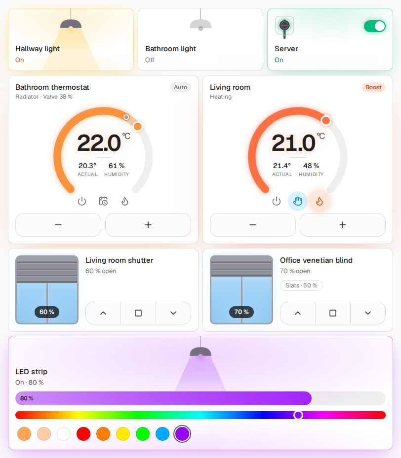

<h1>Kachelwerk: Home-Assistant-Karten, die sich anfühlen wie eine App</h1>

**Rollläden zum Ziehen wie ein Fenster, Lampen, die ihr Licht in die Kachel werfen, ein Thermostat zum Drehen,
ein Ferraris-Zähler, dessen Scheibe sich mit deiner Leistung dreht.** 
Dreizehn Lovelace-Karten für die tägliche Bedienung im Haus, aus den Kacheln von
[ccu-addon-mui](https://github.com/firsttris/ccu-addon-mui). Hell und dunkel nach deinem Theme, deutsch und englisch, eine Datei.

[Installation](#-installation) •
[Karten](#-karten) •
[FAQ](#-faq) •
[Dokumentation (englisch)](https://firsttris.github.io/kachelwerk/) •
[English](README.md)

<picture>
  <source media="(prefers-color-scheme: dark)" srcset="docs/screenshots/hero-dark.png">
  
</picture>

## 💡 Warum Kachelwerk?

Die Kacheln von Home Assistant sind aufgeräumt, aber ein Rollladen ist eine Prozentzahl, eine Lampe ein Symbol
und ein Thermostat eine Zahl. Kachelwerk zeichnet, was du bedienst:

- **Bilder statt Symbole:** Der Rollladen ist ein Fenster zum Ziehen, die Lampe hängt in die Kachel und
  leuchtet sie in ihrer Farbe aus, die Fußbodenheizung füllt sich mit warmem Wasser, so weit das Ventil offen ist.
- **Es zeigt, was passiert:** Ein Rollladen fährt sichtbar zum Ziel, statt auf die alte Position
  zurückzuspringen, die der Aktor während der Fahrt meldet; ein Licht, das am Wandschalter geschaltet wird,
  schwingt und sagt es.
- **Sicher, wo es zählt:** Das Garagentor öffnet nur gedrückt gehalten, die Haustür nur geschoben – ein
  versehentlicher Tipp am Wandtablet öffnet nichts.
- **Fürs Dashboard gemacht:** die Farben deines Themes, hell und dunkel, die Breiten eines Sections-Views,
  ein visueller Editor für jede Option, der Entitäts-Dialog mit einem Tipp.
- **Eine Datei, keine Cloud:** `kachelwerk.js` samt Schrift, installiert über HACS.

Funktioniert mit jeder Integration: Homematic, Zigbee, Matter, Shelly, KNX – alles, was Home Assistant ein
`cover`, ein `light` oder ein `climate` gibt.

## 🚀 Installation

**HACS:** ⋮ → **Benutzerdefinierte Repositories** → `https://github.com/firsttris/kachelwerk`, Typ
**Dashboard** → **Kachelwerk** herunterladen → Seite neu laden.

**Manuell:** `kachelwerk.js` aus dem [neuesten Release](https://github.com/firsttris/kachelwerk/releases/latest)
nach `config/www/kachelwerk/`, dann `/local/kachelwerk/kachelwerk.js` als JavaScript-Modul unter
**Einstellungen → Dashboards → Ressourcen** eintragen.

Danach **Karte hinzufügen** → nach **Kachelwerk** suchen.

## 🧩 Karten

| Karte | Für | |
| --- | --- | --- |
| `kachelwerk-shutter` | `cover` | Fenster zum Ziehen, fährt sichtbar zum Ziel, Lamellen für Raffstores |
| `kachelwerk-light` | `light`, `switch` | Pendelleuchte mit Lichtkegel; Dimmer, Farblicht oder Steckdose |
| `kachelwerk-thermostat` | `climate` | Drehrad; Boost, Auto/Manuell, Komfort und Eco, Fenster offen |
| `kachelwerk-aircon` | `climate` | Klimagerät, aus dem Luft in der Farbe der Betriebsart strömt; Zieltemperatur oder Bereich, Lüfter, Lamellen |
| `kachelwerk-floor` | `number`, `switch` | Heizkreis, der sich mit warmem Wasser füllt; Pumpe |
| `kachelwerk-window` | `binary_sensor`, `sensor` | Fenster gekippt oder offen als Bild; Fenstergriffe |
| `kachelwerk-garage` | `cover` | Sektionaltor; Öffnen gedrückt halten |
| `kachelwerk-lock` | `lock` | Tür mit Riegel; Entsperren halten, Öffnen schieben |
| `kachelwerk-climate-sensor` | `sensor`, `weather` | Temperatur, Feuchte-Ring, Taupunkt, Wetter |
| `kachelwerk-meter` | `sensor` | Ferraris-Stromzähler, Gaszähler |
| `kachelwerk-sensor` | `sensor` | Messwert groß; CO₂, Feinstaub, Bodenfeuchte bewertet |
| `kachelwerk-detector` | `binary_sensor`, `siren` | Rauch, Bewegung, Präsenz, Wasser, Regen, Netzausfall, Sirene |
| `kachelwerk-valve` | `valve`, `switch`, `cover` | Ventile, Bewässerung, Fensterantriebe |
| `kachelwerk-buttons` | `button`, `script`, `event` | Tastenfeld: kurz und lang drücken, Druck am Gerät leuchtet auf |

Optionen, Beispiele und Bilder jeder Karte stehen in der [Dokumentation](https://firsttris.github.io/kachelwerk/).

## ❓ FAQ

**Brauche ich eine Homematic-CCU?** Nein. Die Kacheln stammen aus ccu-addon-mui, in Home Assistant arbeiten sie nur mit
Entitäten und Diensten, aus jeder Integration.

**Warum ist mein Schalter eine Steckdose?** Ein `switch` wird zur Lampe, wenn sein Name oder seine Entity-ID
nach Licht klingt („Licht“, „Lampe“, „LED“ …). Mit `tile: light` entscheidest du selbst.

**Die Fahrt im Bild ist schneller oder langsamer als der echte Rollladen.** `travel_time` auf die Sekunden
setzen, die dein Rollladen von ganz zu bis ganz offen braucht.

**Kann ich Leuchten und Bewegung abschalten?** `effects: off` pro Karte, oder `strong` für mehr.

## 📄 Lizenz

[AGPL-3.0](LICENSE), wie ccu-addon-mui.
