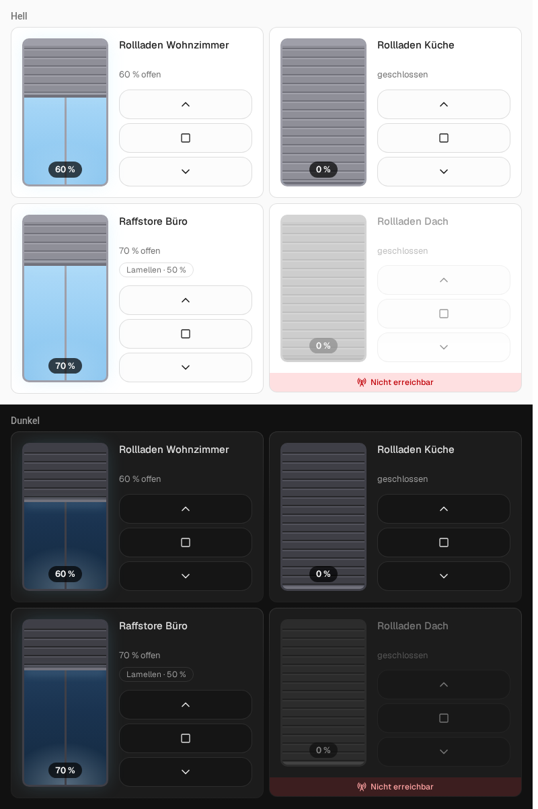
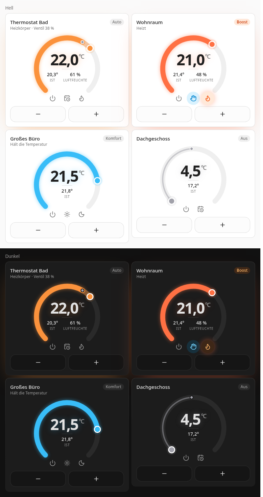

<div align="center">

# Kachelwerk

**Die Kacheln aus [MUI](https://github.com/firsttris/ccu-addon-mui) für Home Assistant.**<br>
Rollladen als Fenster zum Ziehen, Lampen mit Lichtkegel, Thermostate zum Drehen: Karten fürs Dashboard,
die sich anfühlen wie eine App.



</div>

## Karten

| Karte | Für | Stand |
| --- | --- | --- |
| `custom:kachelwerk-shutter` | Rollläden, Raffstores, Markisen (`cover`) | ✅ |
| `custom:kachelwerk-light` | Lampen, Dimmer, Farblicht (`light`), Schalter und Steckdosen (`switch`, `input_boolean`) | ✅ |
| `custom:kachelwerk-thermostat` | Heizkörper- und Wandthermostate (`climate`) | ✅ |
| Fenster, Tür, Sensoren … | | in Arbeit |

### Rollladen

Das Fenster ist der Schieberegler: tippen oder ziehen setzt die Höhe, losgelassen wird einmal gesendet.
Nach einem Befehl fährt der Rollladen sichtbar zum Ziel, statt auf die alte Position zurückzuspringen,
die viele Aktoren während der Fahrt noch melden. Raffstores bekommen einen Regler für die Lamellen.

```yaml
type: custom:kachelwerk-shutter
entity: cover.wohnzimmer
name: Wohnzimmer        # optional, sonst der Name der Entität
travel_time: 25         # optional: Sekunden von unten nach oben, für die Fahrt-Anzeige (Standard 20)
effects: subtle         # optional: off, subtle oder strong (Leuchten und Bewegung)
```

Ein Tipp auf den Namen öffnet den Dialog der Entität. Alle Optionen lassen sich auch im visuellen Editor setzen.

### Licht

Eine Pendelleuchte hängt in die Kachel und wirft eingeschaltet einen Lichtkegel, in der Farbe des Lichts und so
hell wie gedimmt. Welche Kachel eine Entität bekommt, richtet sich nach dem, was sie kann: an/aus, Dimmer
(Helligkeitsbalken) oder Farblicht (Farbe, Weißtöne, Schnellauswahl; doppelt so breit). Schalter werden zur
Lampe, wenn ihr Name nach Licht klingt, sonst zur Steckdose mit Stecker. Tippen schaltet, gedrückt halten öffnet
den Dialog der Entität.

```yaml
type: custom:kachelwerk-light
entity: switch.kaffeemaschine
tile: socket            # optional: light, socket, dimmer oder color
```

### Thermostat

Das Drehrad zeigt Soll- und Ist-Temperatur: ziehen oder mit − und + einstellen, gesendet wird einmal nach der
letzten Änderung. Der Bogen ist orange, solange geheizt wird (`hvac_action`), blau, wenn die Temperatur gehalten
wird, grau aus. Im Rad: Ausschalten, Auto/Manuell (`hvac_mode` auto ↔ heat), Komfort/Eco und Boost, wenn das
Thermostat diese Presets hat.



```yaml
type: custom:kachelwerk-thermostat
entity: climate.bad
window_entity: binary_sensor.fenster_bad     # optional: zeigt „Fenster offen“
valve_entity: sensor.bad_ventil              # optional: Ventilöffnung in %
humidity_entity: sensor.bad_luftfeuchte      # optional, wenn das Thermostat keine Luftfeuchte hat
```

## Installation

### HACS

1. HACS → ⋮ → **Benutzerdefinierte Repositories** → `https://github.com/firsttris/Kachelwerk`, Typ **Dashboard**
2. **Kachelwerk** installieren und die Seite neu laden

### Manuell

`kachelwerk.js` aus dem [neuesten Release](https://github.com/firsttris/Kachelwerk/releases/latest) nach
`config/www/kachelwerk/` legen und unter **Einstellungen → Dashboards → ⋮ → Ressourcen** als
`/local/kachelwerk/kachelwerk.js` (JavaScript-Modul) eintragen.

## Entwicklung

```sh
npm install
npm run dev                    # Demo-Seite mit Beispiel-Entitäten (demo/)
npm test                       # Unit-Tests
npm run build                  # dist/kachelwerk.js
node scripts/shots.mjs         # Screenshots der Demo in hell und dunkel
```

Aufbau und Konventionen: [CLAUDE.md](CLAUDE.md).

## English

Kachelwerk ports the tiles of MUI, a modern web UI for the Homematic CCU, to Home Assistant as Lovelace
cards. The tiles speak German and English, following your HA profile. Install via HACS as a custom
repository (type Dashboard).

## Lizenz

[AGPL-3.0](LICENSE), wie MUI.
