<div align="center">


<h1>Kachelwerk: Home Assistant cards that feel like an app</h1>

**Shutters you drag like a window, lamps that cast their light into the tile, a thermostat dial, a Ferraris
meter whose disc turns with your power.**<br>
Thirteen Lovelace cards for the everyday controls of a home, from the tiles of
[MUI](https://github.com/firsttris/ccu-addon-mui). Light and dark with your theme, German and English, one file.

[](https://github.com/firsttris/kachelwerk/actions/workflows/ci.yml)
[](https://github.com/firsttris/kachelwerk/releases/latest)
[](https://firsttris.github.io/kachelwerk/installation.html)
[](https://firsttris.github.io/kachelwerk/)
[](LICENSE)
<br>
[](https://www.home-assistant.io/)
[](https://firsttris.github.io/kachelwerk/appearance.html#width)
[](https://preactjs.com/)
[](https://www.typescriptlang.org/)
[](https://firsttris.github.io/kachelwerk/)

```yaml
type: custom:kachelwerk-light
entity: light.dining_table
```

[Install](#-install) •
[Cards](#-cards) •
[FAQ](#-faq) •
[Documentation](https://firsttris.github.io/kachelwerk/) •
[Deutsch](README.de.md)

<picture>
  <source media="(prefers-color-scheme: dark)" srcset="docs/screenshots/hero-dark.png">
  
</picture>

</div>

## 💡 Why Kachelwerk?

Home Assistant's tile cards are tidy, but a shutter is a percentage, a lamp an icon and a thermostat a
number. Kachelwerk draws what you control:

- **Pictures instead of icons:** the shutter is a window you drag, the lamp hangs into the tile and lights
  it in its own color, the floor heating loop fills with warm water as far as its valve is open.
- **It shows what happens:** a shutter travels to its target instead of jumping back to the old position
  the actuator reports while it moves; a light switched at the wall swings and says so.
- **Safe where it matters:** opening the garage has to be held, the front door slid open, so a stray tap
  on the wall tablet never opens anything.
- **Made for your dashboard:** your theme's colors, light and dark, the widths of a sections view, a
  visual editor for every option, more-info on a tap.
- **One file, no cloud:** `kachelwerk.js` with its font, installed by HACS.

Works with any integration: Homematic, Zigbee, Matter, Shelly, KNX, whatever gives Home Assistant a cover,
a light or a climate entity.

## 🚀 Install

**HACS:** ⋮ → **Custom repositories** → `https://github.com/firsttris/kachelwerk`, type **Dashboard** →
download **Kachelwerk** → reload the page.

**Manually:** `kachelwerk.js` from the [latest release](https://github.com/firsttris/kachelwerk/releases/latest)
to `config/www/kachelwerk/`, then add `/local/kachelwerk/kachelwerk.js` as a JavaScript module under
**Settings → Dashboards → Resources**.

Then **Add card** → search for **Kachelwerk**. More in the [installation guide](https://firsttris.github.io/kachelwerk/installation.html).

## 🧩 Cards

| | |
| --- | --- |
| **[Shutter](https://firsttris.github.io/kachelwerk/cards/shutter.html)** `cover`<br>A window to drag; travels to its target, slats for venetian blinds.<br>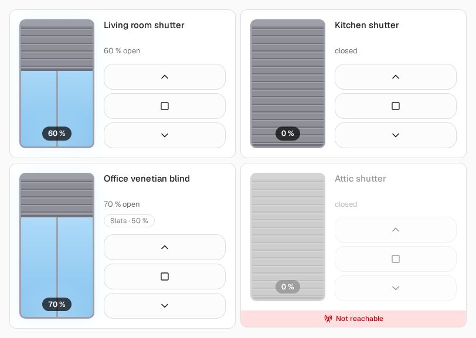 | **[Light](https://firsttris.github.io/kachelwerk/cards/light.html)** `light` `switch`<br>A pendant lamp with its cone of light; dimmer, color light or socket.<br>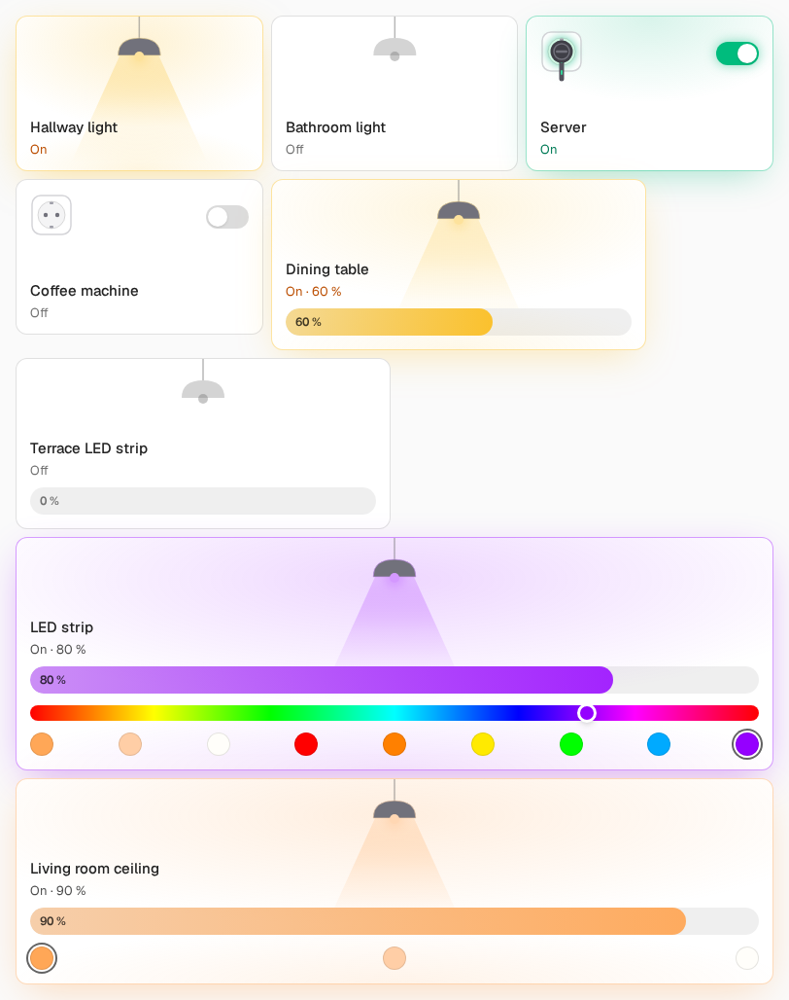 |
| **[Thermostat](https://firsttris.github.io/kachelwerk/cards/thermostat.html)** `climate`<br>A dial; boost, automatic/manual, comfort and eco, window open.<br>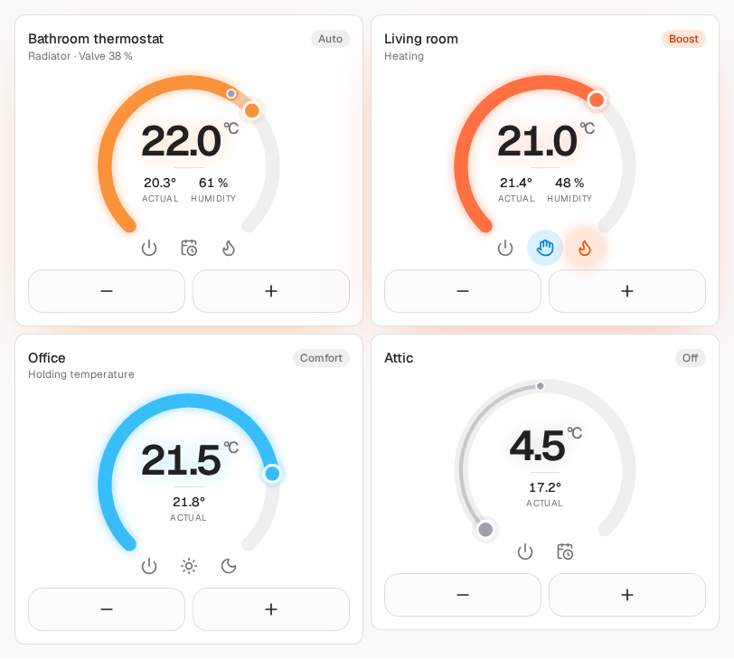 | **[Floor heating](https://firsttris.github.io/kachelwerk/cards/floor.html)** `number` `switch`<br>The heating loop fills with warm water; the pump.<br>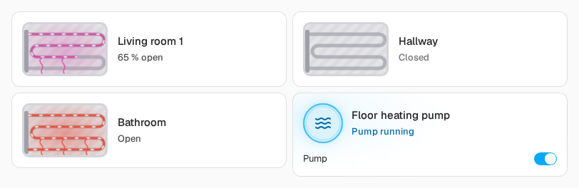 |
| **[Window](https://firsttris.github.io/kachelwerk/cards/window.html)** `binary_sensor` `sensor`<br>Tilted or open as a picture; window handles turn their knob.<br>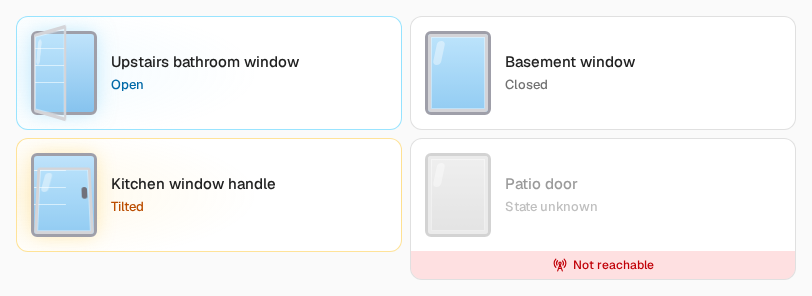 | **[Detector](https://firsttris.github.io/kachelwerk/cards/detector.html)** `binary_sensor` `siren`<br>Smoke, motion, presence, water, rain, mains failure, sirens.<br>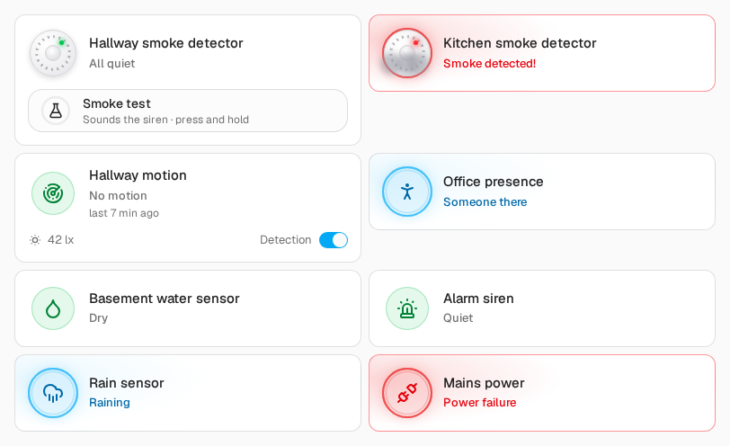 |
| **[Lock](https://firsttris.github.io/kachelwerk/cards/lock.html)** `lock`<br>Lock with a tap, unlock by holding, open by sliding.<br>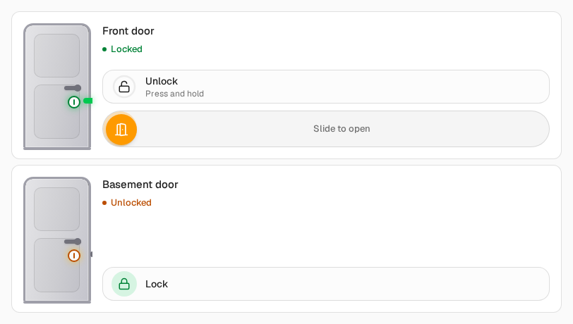 | **[Garage door](https://firsttris.github.io/kachelwerk/cards/garage.html)** `cover`<br>A sectional door; opening has to be held.<br>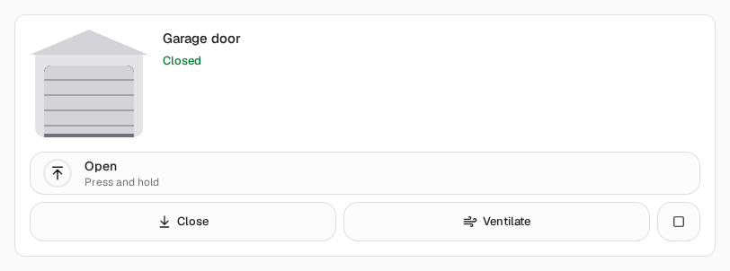 |
| **[Meter](https://firsttris.github.io/kachelwerk/cards/meter.html)** `sensor`<br>A Ferraris meter whose disc turns with the power, a gas meter.<br>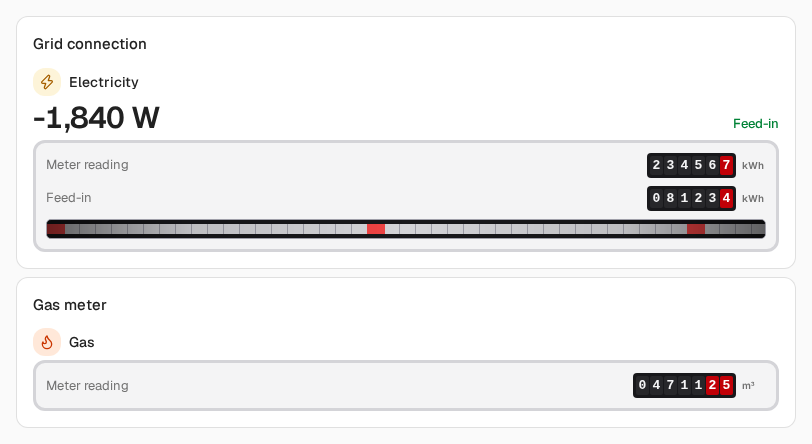 | **[Climate sensor](https://firsttris.github.io/kachelwerk/cards/climate-sensor.html)** `sensor` `weather`<br>Temperature, a humidity ring, dew point, wind and rain.<br>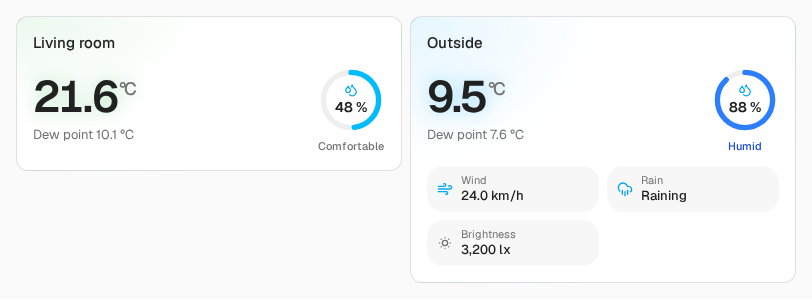 |
| **[Sensor](https://firsttris.github.io/kachelwerk/cards/sensor.html)** `sensor`<br>One value large; CO₂, particulate matter and soil moisture rated.<br>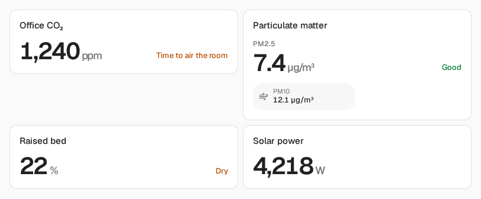 | **[Valve](https://firsttris.github.io/kachelwerk/cards/valve.html)** `valve` `switch` `cover`<br>Valves, irrigation, window drives.<br>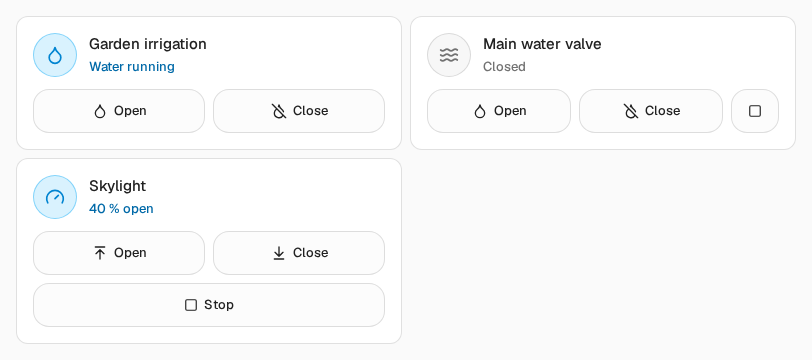 |
| **[Buttons](https://firsttris.github.io/kachelwerk/cards/buttons.html)** `button` `script` `event`<br>A keypad: short and long press, presses at the device light up.<br>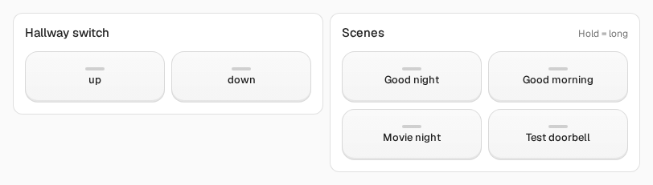 | |

Every picture in light and dark is in the [documentation](https://firsttris.github.io/kachelwerk/).

## ❓ FAQ

### Do I need a Homematic CCU?

No. The cards come from MUI, a web UI for the Homematic CCU, but in Home Assistant they work with entities
and services only, from any integration.

### Why is my switch shown as a socket?

A `switch` becomes a lamp when its name (or its entity id) sounds like a light: "Licht", "Lampe", "light",
"lamp", "LED" and the like. Anything else is a socket with a plug. `tile: light` decides it yourself.

### Can I change how wide a card is?

Yes, in a sections view under **Layout** in the card editor. Every card brings a width that suits it and
rearranges itself on narrow cards. See [Look and feel](https://firsttris.github.io/kachelwerk/appearance.html#width).

### The shutter's travel in the card is faster or slower than the real one

Set `travel_time` to the seconds your shutter takes from fully closed to fully open.

### Can I turn the glow and the animations off?

`effects: off` per card, or `strong` for more. With "reduce motion" in your operating system nothing moves.

## 📚 Documentation

[firsttris.github.io/kachelwerk](https://firsttris.github.io/kachelwerk/): every card with its options and
an example, [installation](https://firsttris.github.io/kachelwerk/installation.html),
[look and feel](https://firsttris.github.io/kachelwerk/appearance.html),
[development](https://firsttris.github.io/kachelwerk/development.html).

## 🛠️ Development

```sh
npm install
npm run dev            # the demo page with example entities
npm test               # unit tests
npm run test:e2e       # the cards clicked through in a browser
npm run build          # dist/kachelwerk.js
npm run screenshots    # docs/screenshots
```

How the cards are built: [CLAUDE.md](CLAUDE.md) and the [development page](https://firsttris.github.io/kachelwerk/development.html).

## 🤝 Contributing

Issues and pull requests are welcome. A change to a card that comes from MUI is best made in
[MUI](https://github.com/firsttris/ccu-addon-mui) too, so both stay alike.

## 📄 License

[AGPL-3.0](LICENSE), like MUI.
