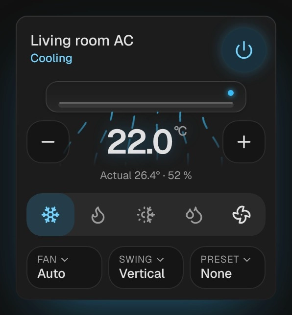

# Air conditioner

`custom:kachelwerk-aircon` · for `climate`

{ width="480" }

An indoor unit with the air streaming out of it: sky blue while it cools, orange while it heats, teal
while it dries, grey with only the fan. The streams flow faster with a higher fan speed and sway while
the louvre swings. Below are the target temperature, the modes, and the fan, swing and preset.

## Using it

- − and + step the target (`target_temp_step`, else 0.5); quick steps are sent once, half a second after the last one.
- In `heat_cool` with a range (`target_temp_low`/`target_temp_high`): tap "Heat to" or "Cool to", then − and +. Both ends are sent together and never pass each other.
- Without a target (off, often fan only) the room's temperature is shown large.
- The mode buttons are the entity's `hvac_modes` (without `off`); the active one in its color. `heat_cool` and `auto` take the color of what the unit does (`hvac_action`).
- The power button uses `climate.turn_off`/`turn_on` where the entity supports them, else the `hvac_mode` off (and, to turn on, the first of heat_cool, heat, cool, as Home Assistant does).
- Fan speed, swing, horizontal swing and preset appear where the entity supports them; a tap opens the phone's own picker.
- Range and step come from the entity (`min_temp`, `max_temp`, `target_temp_step`).

## Options

| Option | Default | |
| --- | --- | --- |
| `entity` | required | The entity the card shows. |
| `name` |  | Shown instead of the entity's name. |
| `effects` | `subtle` | Glow and motion: `off`, `subtle` or `strong`. See [Look and feel](../appearance.md#effects). |

All options can be set in the visual editor too.

```yaml
type: custom:kachelwerk-aircon
entity: climate.living_room_ac
```

## What it calls

`climate.set_temperature`, `climate.set_hvac_mode`, `climate.turn_on`, `climate.turn_off`,
`climate.set_fan_mode`, `climate.set_swing_mode`, `climate.set_swing_horizontal_mode`,
`climate.set_preset_mode`.

## Light and dark


