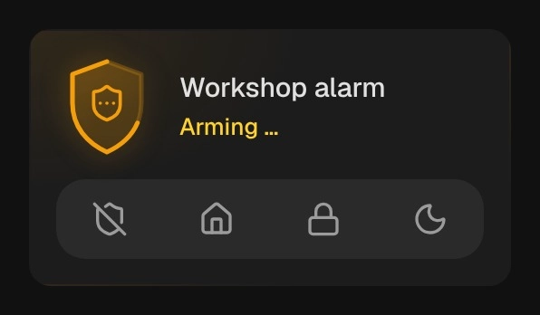

# Alarm panel

`custom:kachelwerk-alarm` · for `alarm_control_panel`

{ width="480" }

The panel as a shield in the color of its state: green and outlined while disarmed, filled blue while
armed, amber while it is on the way (arming, pending, disarming), with its edge running out like a
countdown, and red with spreading waves and a glowing tile when the alarm is triggered. The icon in the
shield is the mode (home, away, night, vacation, custom bypass). Below are the modes as segments and,
only when a code is needed, a keypad.

## Using it

- The segments are disarmed and the arm modes the entity supports (`supported_features`: arm home 1,
  away 2, night 4, custom bypass 16, vacation 32); the mode it is in is colored.
- With a `code_format`, disarming asks for the code; arming too while `code_arm_required` is true
  (Home Assistant's default). A tap on the mode opens the pad, ✓ sends the code with the service call.
  Without a code a tap is enough.
- `code_format: number` gets a number pad, `text` a password field. The code is shown as dots only, is
  never logged and is forgotten once the pad closes.
- While `pending` or `triggered` the pad to disarm is open right away.
- The siren button (with `supported_features` trigger 8) sets the alarm off; it has to be held.
- `changed_by` is shown under the state where the integration reports it.
- A tap on the name opens Home Assistant's more-info dialog.

## Options

| Option | Default | |
| --- | --- | --- |
| `entity` | required | The entity the card shows. |
| `name` |  | Shown instead of the entity's name. |
| `effects` | `subtle` | Glow and motion: `off`, `subtle` or `strong`. See [Look and feel](../appearance.md#effects). |

All options can be set in the visual editor too.

```yaml
type: custom:kachelwerk-alarm
entity: alarm_control_panel.home
```

## What it calls

`alarm_control_panel.alarm_disarm`, `alarm_arm_home`, `alarm_arm_away`, `alarm_arm_night`,
`alarm_arm_vacation`, `alarm_arm_custom_bypass` and `alarm_trigger`, each with `code` when one was typed.

## Light and dark


