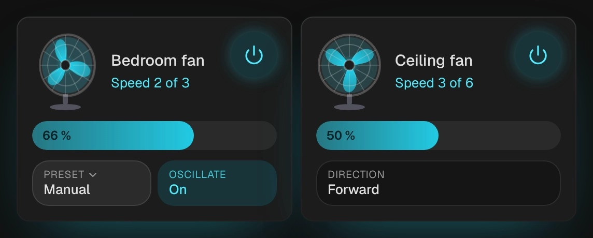

# Fan

`custom:kachelwerk-fan` · for `fan`

{ width="480" }

A pedestal fan whose blades turn with the speed: slowly at the lowest step, a blur at full speed. They
spin up and coast down like a real fan, turn the other way in reverse, and the head sweeps from side to
side while the fan oscillates. Below are the speed as a bar, the preset, oscillation and direction.

## Using it

- The bar sets the speed (`fan.set_percentage`): drag it or tap it; the value is sent once on release. It snaps to the fan's speeds (`percentage_step`): a fan with three speeds goes to 33, 66 and 100 %, as Home Assistant computes them. 0 % turns the fan off.
- With a handful of speeds the state line reads "Speed 2 of 3".
- Presets (`preset_modes`) open the phone's own picker; "Manual" is shown while no preset is set (a speed ends a preset).
- Oscillate and direction are switched with a tap (`fan.oscillate`, `fan.set_direction`).
- The power button uses `fan.turn_on` and `fan.turn_off`.
- Each control appears only where the fan supports it (`FanEntityFeature`: set speed, oscillate, direction, preset mode, turn on, turn off).
- A tap on the name opens Home Assistant's more-info dialog.

## Options

| Option | Default | |
| --- | --- | --- |
| `entity` | required | The entity the card shows. |
| `name` |  | Shown instead of the entity's name. |
| `effects` | `subtle` | Glow and motion: `off`, `subtle` or `strong`. See [Look and feel](../appearance.md#effects). |

All options can be set in the visual editor too.

```yaml
type: custom:kachelwerk-fan
entity: fan.bedroom
```

## What it calls

`fan.turn_on`, `fan.turn_off`, `fan.set_percentage`, `fan.set_preset_mode`, `fan.oscillate`,
`fan.set_direction`.

## Light and dark


