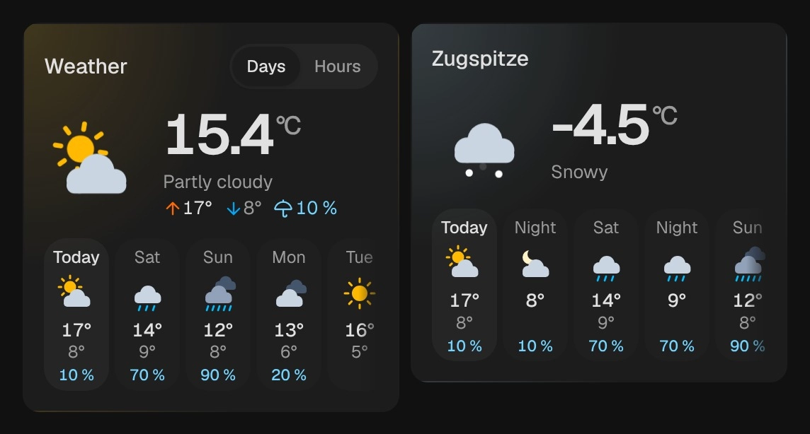

# Forecast

`custom:kachelwerk-forecast` · for `weather`

{ width="480" }

The weather now as a picture that moves: the sun's rays turn, clouds drift, rain, snow and hail fall,
lightning flashes, fog and wind pass by. Next to it the temperature with today's high, low and chance of
rain, below it the forecast for the coming days or hours.

## Using it

- The forecast comes as Home Assistant's own weather card gets it, through the subscription
  `weather/subscribe_forecast`, and updates whenever the integration has a new one.
- Days, hours or day and night (`twice_daily`), as far as the weather entity offers them; with more than
  one, a switch above the picture changes between them.
- The strip shows up to ten days, a day of hours or a week of days and nights. What does not fit scrolls
  sideways; its ends fade out where there is more.
- Below each entry the chance of precipitation from 10 %, or the amount where the integration gives no chance.
- At night (`sun.sun` below the horizon) the moon takes the sun's place, for the hours after sunset too.
- A tap on the name opens Home Assistant's dialog of the weather entity.
- For the current values of a weather station (humidity, dew point, wind, rain) there is the
  [climate sensor](climate-sensor.md).

## Options

| Option | Default | |
| --- | --- | --- |
| `entity` | required | The entity the card shows. |
| `name` |  | Shown instead of the entity's name. |
| `forecast_type` | first offered | `daily`, `hourly` or `twice_daily`: what the strip shows first. |
| `effects` | `subtle` | Glow and motion: `off`, `subtle` or `strong`. See [Look and feel](../appearance.md#effects). |

All options can be set in the visual editor too.

```yaml
type: custom:kachelwerk-forecast
entity: weather.home
forecast_type: hourly
```

## What it calls

Nothing: it subscribes to the forecast (`weather/subscribe_forecast`) and shows it.

## Light and dark


