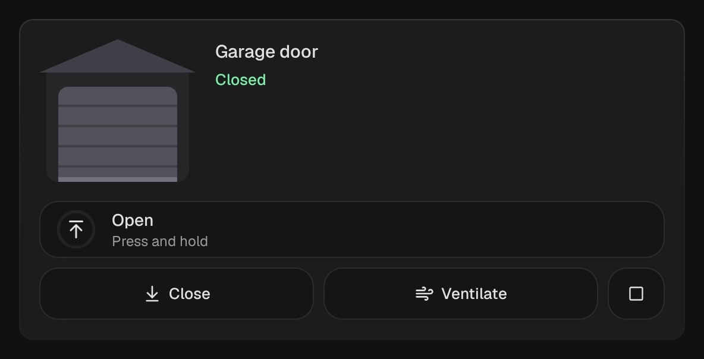

# Garage door

`custom:kachelwerk-garage` · for `cover`

{ width="480" }

A garage whose sectional door rolls up and down; a lamp lights up inside while it is open.

## Using it

- Opening has to be **held**, so a stray tap never opens the garage.
- Close, ventilation (15 %, for doors that go to a position) and stop are a tap.
- While Home Assistant reports `opening` or `closing`, the door is drawn moving.

## Options

| Option | Default | |
| --- | --- | --- |
| `entity` | required | The entity the card shows. |
| `name` |  | Shown instead of the entity's name. |
| `effects` | `subtle` | Glow and motion: `off`, `subtle` or `strong`. See [Look and feel](../appearance.md#effects). |

All options can be set in the visual editor too.

```yaml
type: custom:kachelwerk-garage
entity: cover.garage_door
```

## What it calls

`cover.open_cover`, `cover.close_cover`, `cover.set_cover_position`, `cover.stop_cover`.

## Light and dark


