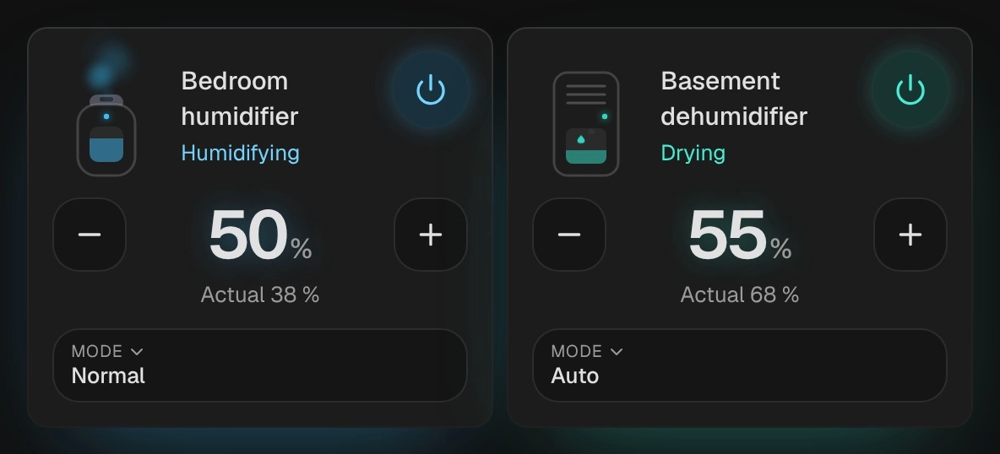

# Humidifier

`custom:kachelwerk-humidifier` · for `humidifier`

{ width="480" }

A humidifier with mist rising from its nozzle while it humidifies, or, for the `dehumidifier` device
class, a cabinet whose tank collects drops while it dries. Sky blue for humidifying, teal for drying,
grey while idle or off. Below are the target humidity with − and +, the room's humidity and the mode.

## Using it

- − and + step the target (`target_humidity_step`, else 1 %); quick steps are sent once, half a second after the last one, in whole percents within `min_humidity` and `max_humidity`.
- The state line shows what the device does (`action`: humidifying, drying, idle, off); without an action, an entity that is on works as its device class does.
- Without a target the room's humidity (`current_humidity`) is shown large.
- The mode (`available_modes`, with the `MODES` feature) opens the phone's own picker.
- The power button uses `humidifier.turn_on` and `humidifier.turn_off`.
- A tap on the name opens Home Assistant's more-info dialog.

## Options

| Option | Default | |
| --- | --- | --- |
| `entity` | required | The entity the card shows. |
| `name` |  | Shown instead of the entity's name. |
| `effects` | `subtle` | Glow and motion: `off`, `subtle` or `strong`. See [Look and feel](../appearance.md#effects). |

All options can be set in the visual editor too.

```yaml
type: custom:kachelwerk-humidifier
entity: humidifier.bedroom
```

## What it calls

`humidifier.turn_on`, `humidifier.turn_off`, `humidifier.set_humidity`, `humidifier.set_mode`.

## Light and dark


