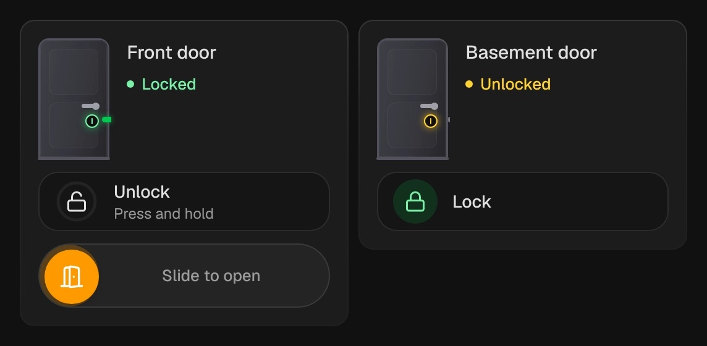

# Lock

`custom:kachelwerk-lock` · for `lock`

{ width="480" }

A door with its bolt: green when locked, amber when unlocked. "Open" swings the door and warm light falls through it.

## Using it

- Locking is a tap.
- Unlocking has to be **held**.
- Opening the latch (locks with the open feature) has to be **slid** all the way, so wiping the wall tablet never opens the front door.
- A jammed lock shows a fault.

## Options

| Option | Default | |
| --- | --- | --- |
| `entity` | required | The entity the card shows. |
| `name` |  | Shown instead of the entity's name. |
| `effects` | `subtle` | Glow and motion: `off`, `subtle` or `strong`. See [Look and feel](../appearance.md#effects). |

All options can be set in the visual editor too.

```yaml
type: custom:kachelwerk-lock
entity: lock.front_door
```

## What it calls

`lock.lock`, `lock.unlock`, `lock.open`.

## Light and dark


