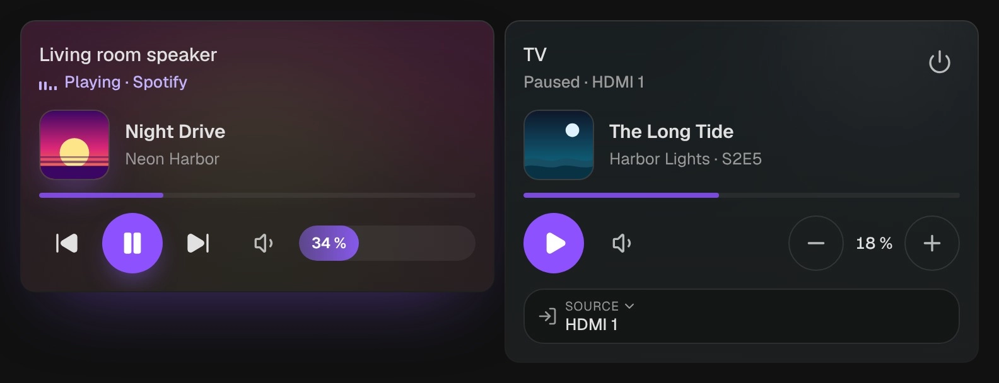

# Media player

`custom:kachelwerk-media` · for `media_player`

{ width="480" }

What plays, with its cover, and the cover blurred behind the whole tile: Sonos, Spotify, a TV, a
Chromecast or an AV receiver. While it plays, a small equalizer dances next to "Playing" and a thin
line shows how far the track is. Below are play and pause, the tracks, the volume, and the source
and sound mode.

## Using it

- The middle button pauses while it plays (`media_pause`; `media_stop` where the player can't pause) and plays otherwise (`media_play`).
- Previous and next appear where the player supports them (`PREVIOUS_TRACK`, `NEXT_TRACK`).
- The volume is a bar to drag or tap (`volume_set`), sent once on release; arrow keys step it by 5 %. Players that can only step (`VOLUME_STEP` without `VOLUME_SET`) get − and + (`volume_up`, `volume_down`).
- The speaker button mutes and unmutes (`volume_mute`); muted, the bar fades.
- Source and sound mode appear where the entity supports them and lists them (`source_list`, `sound_mode_list`); a tap opens the phone's own picker.
- The power button uses `turn_on` and `turn_off`, each only where the entity supports it. Off (or in standby) the tile shows only its name and the power button: Home Assistant reports nothing else then.
- Under the title the artist, else the series with season and episode, the channel or the album; next to the state the app (`app_name`) or the source.
- The cover is `entity_picture`. Home Assistant's own proxy path (`/api/media_player_proxy/…`) is made absolute with the frontend's `hassUrl`, so it loads in the companion app too; a cover that doesn't load is left out.
- A tap on the name opens Home Assistant's more-info dialog, with shuffle, repeat, seeking and browsing.

## Options

| Option | Default | |
| --- | --- | --- |
| `entity` | required | The entity the card shows. |
| `name` |  | Shown instead of the entity's name. |
| `effects` | `subtle` | Glow and motion: `off`, `subtle` or `strong`. See [Look and feel](../appearance.md#effects). |

All options can be set in the visual editor too.

```yaml
type: custom:kachelwerk-media
entity: media_player.living_room
```

## What it calls

`media_player.media_play`, `media_player.media_pause`, `media_player.media_stop`,
`media_player.media_previous_track`, `media_player.media_next_track`, `media_player.volume_set`,
`media_player.volume_up`, `media_player.volume_down`, `media_player.volume_mute`,
`media_player.select_source`, `media_player.select_sound_mode`, `media_player.turn_on`,
`media_player.turn_off`.

## Light and dark


