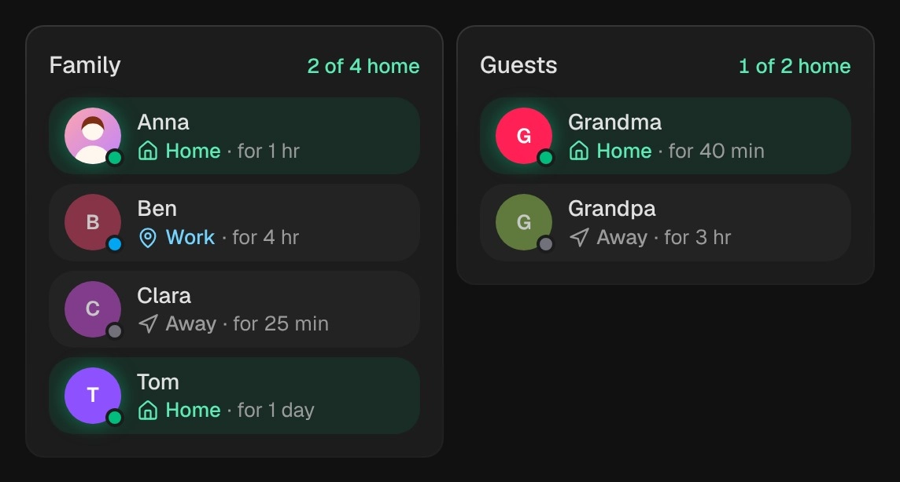

# Presence

`custom:kachelwerk-presence` · for `person`, `device_tracker`

{ width="480" }

Who is home: the people of the house in one tile, each with their picture (or initials in a colored
circle), where they are and for how long. Those at home are green and their picture glows; a ring spreads
from it when someone comes home.

## Using it

- `home` is shown as Home, `not_home` as Away; any other state is the zone the person is in (Home
  Assistant sets the zone's name as the state). Where the zone exists, its name is shown as you wrote it.
- The time is how long the state has not changed (`last_changed`): "for 25 min", "for 4 hr", "for 2 days".
- The picture is the person's `entity_picture`, set under **Settings → People**.
- A tap on a person opens Home Assistant's dialog with the map and the history.
- With more than one person the header counts who is home. On a wide card the people sit in two columns.

## Options

| Option | Default | |
| --- | --- | --- |
| `entity` | required | The first person. |
| `entities` |  | More people: entity ids, or `entity` and `name` each. |
| `name` | Presence | The title of the tile. |
| `effects` | `subtle` | Glow and motion: `off`, `subtle` or `strong`. See [Look and feel](../appearance.md#effects). |

All options can be set in the visual editor too.

```yaml
type: custom:kachelwerk-presence
name: Family
entity: person.anna
entities:
  - person.ben
  - entity: device_tracker.grandpas_phone
    name: Grandpa
```

## What it calls

Nothing: it only shows where people are.

## Light and dark


