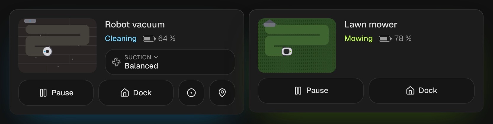

# Robot vacuum and lawn mower

`custom:kachelwerk-robot` · for `vacuum`, `lawn_mower`

{ width="480" }

One card, two looks: a round robot vacuum on a wooden floor, or a mower on its lawn. While it cleans
or mows, the robot drives its lanes and leaves a clean (or mown) stripe behind it; on its way home
it drives back to the station, docked it sits there and the station's light pulses green. A paused
robot stops where it is, one with an error stands askew with a red ring.

## Using it

- The big button starts (`vacuum.start`, `lawn_mower.start_mowing`), resumes when paused, and pauses
  while it works. A robot that can't pause gets Stop instead.
- **Dock** sends it home (`vacuum.return_to_base`, `lawn_mower.dock`); it is greyed out while the
  robot is docked or already on its way.
- Vacuums that support them get **Spot clean** (`vacuum.clean_spot`), **Locate** (`vacuum.locate`,
  it beeps) and **Suction**, the `fan_speed_list` to pick from; a tap opens the phone's own picker.
- Every button only appears with its feature flag (`VacuumEntityFeature`, `LawnMowerEntityFeature`),
  as Home Assistant only accepts the service then.
- The battery is shown as a small bar. Vacuums no longer report `battery_level` in current Home
  Assistant and lawn mowers never did, so give the card the robot's battery sensor with
  `battery_entity`; an older vacuum's `battery_level` is used when there is no sensor.

## Options

| Option | Default | |
| --- | --- | --- |
| `entity` | required | The `vacuum` or `lawn_mower` entity. |
| `name` |  | Shown instead of the entity's name. |
| `battery_entity` |  | A battery sensor (percent) for the bar. |
| `effects` | `subtle` | Glow and motion: `off`, `subtle` or `strong`. See [Look and feel](../appearance.md#effects). |

All options can be set in the visual editor too.

```yaml
type: custom:kachelwerk-robot
entity: vacuum.robot_vacuum
battery_entity: sensor.robot_vacuum_battery
```

## What it calls

`vacuum.start`, `vacuum.pause`, `vacuum.stop`, `vacuum.return_to_base`, `vacuum.clean_spot`,
`vacuum.locate`, `vacuum.set_fan_speed`; `lawn_mower.start_mowing`, `lawn_mower.pause`,
`lawn_mower.stop`, `lawn_mower.dock`.

## Light and dark


