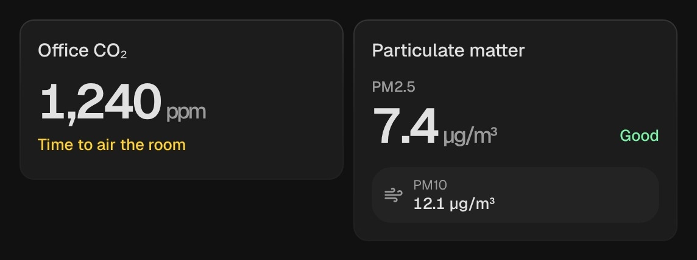

# Sensor

`custom:kachelwerk-sensor` · for `sensor`, `number`, `input_number`

{ width="480" }

One value large with its unit, rated where there is a rating that means something.

## Using it

- **CO₂** as the German Environment Agency rates indoor air: below 1000 ppm good, up to 2000 ppm ventilate, above bad.
- **Particulate matter PM2.5** by the European Air Quality Index.
- **Soil moisture** dry, moist or wet.
- Every other sensor plainly large with its unit.

## Options

| Option | Default | |
| --- | --- | --- |
| `entity` | required | The entity the card shows. |
| `name` |  | Shown instead of the entity's name. |
| `kind` | by the device class | `co2`, `pm25`, `soil`, `illuminance` or `plain`. |
| `pm10_entity` |  | PM10 below the value. |
| `temperature_entity` |  | Temperature below the value. |
| `humidity_entity` |  | Humidity below the value. |
| `effects` | `subtle` | Glow and motion: `off`, `subtle` or `strong`. See [Look and feel](../appearance.md#effects). |

All options can be set in the visual editor too.

```yaml
type: custom:kachelwerk-sensor
entity: sensor.office_co2
```

## What it calls

None, the card only shows.

## Light and dark


