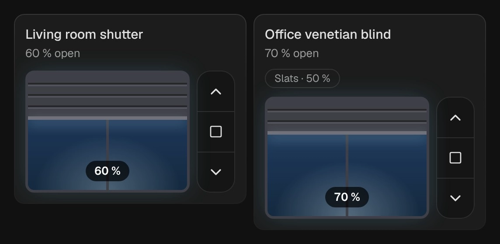

# Shutter

`custom:kachelwerk-shutter` · for `cover`

{ width="480" }

Roller shutters, venetian blinds and awnings. The window is the slider: tap or drag anywhere in it to set the height, the shutter follows your finger and the new position is sent once when you let go.

## Using it

- Up, stop and down buttons beside the window.
- After a command the shutter travels to its target at an estimated pace instead of jumping back to the old position many actuators report while they move. Set `travel_time` to your shutter's real travel time for a true-to-life picture.
- Venetian blinds (covers that can set a tilt position) get a slats control under the name.
- Covers without positions open on a tap in the upper half and close on one in the lower half.
- Arrow keys, Home and End move a focused window in 5 % steps.

## Options

| Option | Default | |
| --- | --- | --- |
| `entity` | required | The entity the card shows. |
| `name` |  | Shown instead of the entity's name. |
| `travel_time` | `20` | Seconds from fully closed to fully open, for the travel shown while the shutter moves. |
| `effects` | `subtle` | Glow and motion: `off`, `subtle` or `strong`. See [Look and feel](../appearance.md#effects). |

All options can be set in the visual editor too.

```yaml
type: custom:kachelwerk-shutter
entity: cover.living_room
name: Living room
travel_time: 25
```

## What it calls

`cover.set_cover_position`, `cover.stop_cover`, `cover.set_cover_tilt_position`; `cover.open_cover` / `cover.close_cover` for covers without positions.

## Light and dark


