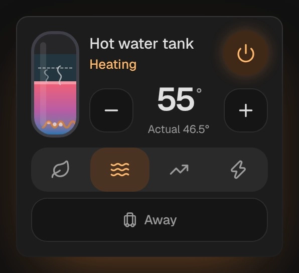

# Water heater

`custom:kachelwerk-water-heater` · for `water_heater`

{ width="480" }

A hot water tank whose water shows its temperature: it rises the warmer it is, cold blue at the
bottom and the warm color of its temperature at the top; a dashed line marks the target. While the
heater heats, the element at the bottom glows and bubbles rise; hot water (45 °C / 113 °F and more)
steams. Beside it are the name and the target with − and +, below the operation modes and away mode.
For boilers, heat pump water heaters and instantaneous heaters.

## Using it

- − and + step the target (`target_temp_step`, else 0.5 in °C and 1 in °F); quick steps are sent once, half a second after the last one.
- The water's temperature (`current_temperature`) is under the target. Where the heater has no target to set, it is shown large.
- Home Assistant doesn't report whether a water heater is heating: the card shows "Heating" while it is on and the water is below the target, else "Holding temperature".
- The mode buttons are the entity's `operation_list` (eco, electric, gas, heat pump, high demand, performance, and an integration's own), without `off`; the active one is named where there is room.
- The power button uses `water_heater.turn_off`/`turn_on` where the entity supports them, else the operation mode `off` (and, to turn on, the first other mode of the list).
- Away mode appears where the entity supports it, as a chip to toggle.
- `target_temp_low`/`target_temp_high`, which some heaters report, are shown under the target; Home Assistant sets only one temperature.
- The tank's scale goes from cold tap water (10 °C / 50 °F) to `max_temp`; the range of the target is `min_temp` to `max_temp`.

## Options

| Option | Default | |
| --- | --- | --- |
| `entity` | required | The entity the card shows. |
| `name` |  | Shown instead of the entity's name. |
| `effects` | `subtle` | Glow and motion: `off`, `subtle` or `strong`. See [Look and feel](../appearance.md#effects). |

All options can be set in the visual editor too.

```yaml
type: custom:kachelwerk-water-heater
entity: water_heater.hot_water_tank
```

## What it calls

`water_heater.set_temperature`, `water_heater.set_operation_mode`, `water_heater.set_away_mode`,
`water_heater.turn_on`, `water_heater.turn_off`.

## Light and dark


